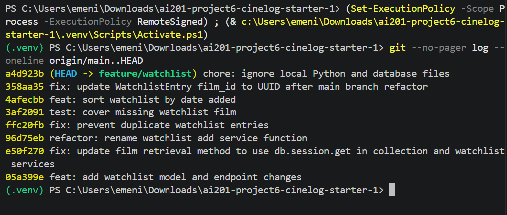

# PR Response Doc — CineLog Watchlist Feature

## AI Usage
I used AI to make sure I understood the codebase myself by explaining the model, service, and test patterns, and to help locate all references to the watchlist service function before renaming it. I checked those explanations against the source. I also used AI to inspect the commit messages against the project's Conventional Commit guidance.

For Comments 4 and 5, I asked AI: “What counterargument would a careful code reviewer raise against this position? What tradeoff am I not acknowledging?” It pointed out that `public` is not enforced by the current read route and that newest-first may not represent the user's intended watch order. I added both considerations to my responses. The decisions remain to favor community discovery with public-by-default entries and to show recent additions first, hownthe maintainer's prefers it.

## Comment 1 — Rename
**What I did:** Renamed `save_to_watchlist()` to `add_to_watchlist()` in the watchlist service and updated the route import and call site.
**How I verified:** Performed a project wide search and found no remaining `save_to_watchlist` references. The service and route imports passed a smoke test, and the existing collection tests passed.

## Comment 2 — Deduplication
**What I did:** Followed `add_to_collection()` in `services/collection_service.py`. It checks for an existing entry matching both `user_id` and `film_id`, and raises `AlreadyInCollectionError` instead of creating a duplicate. `add_to_watchlist()` now uses the same lookup pattern and raises `AlreadyOnWatchlistError` when a match exists. The route returns HTTP 409 for that conflict.
**How I verified:** Using an in memory database, I confirmed the first POST returns 201, a repeated POST returns 409, and exactly one watchlist entry is stored. The existing collection test suite also passed for this comment.

## Comment 3 — Missing test
**What I did:** Added `test_add_to_watchlist_nonexistent_film_raises` in `tests/test_watchlist.py`, using the in memory app and sample user fixture pattern from `tests/test_collection.py`.
**How I verified:** Ran `pytest tests/test_watchlist.py -v`which passed.

## Comment 4 — Default visibility
**My position:** Keep watchlist entries public by default.
**Reasoning:** CineLog is a community film tracking app, and a watchlist can help other users discover films and understand what someone plans to watch. A public default supports that sharing and discovery goal without requiring an extra step. I think it is a great way to build community on the app and deter other from isolation. If people would prefer to be a little more private they dont have to link identifiable information to their account.
**Tradeoff acknowledgedment:** Some users treat a watchlist as a personal planning tool and may expect it to be private. A private-by-default policy would better protect that expectation, but would make sharing and discovery opt-in. It could be a consideration to have private lists that you can opt into that the app does not necesarily promote.

## Comment 5 — Sort order
**My position:** Use date-added order, newest first, as the maintainer suggested.
**Reasoning:** A watchlist is primarily a personal queue of films the user plans to watch. Showing recent additions first makes the newest intentions immediately visible, which is more useful for deciding what to watch next than alphabetical organization.
**Engagement with reviewer's point:** I agree with the maintainer that users commonly want to see what they added recently. Alphabetical order can help locate a title in a long list, but it hides recency and gives new additions no priority.Most people can leave old shows they never plan to watch in the watchlist out of laziness. Alphabetical order would make it so you see the same things every time you open the list and deter you from enjoying its use.
**Tradeoff acknowledgedment:** A counterargument is that the newest addition is not necessarily the next film the user intends to watch. I think makybe a survey amongst users about their preferences or releasing an alphabetical version to some and test how it changes their use of it may be a good way to actually know what users prefer.

## Comment 6 — Rebase
**What conflicted:** Rebasing the watchlist model commit onto `origin/main` conflicted on `WatchlistEntry.film_id`: the watchlist branch used an integer foreign key, while main had migrated `Film.id` and the collection foreign key to UUID strings.
**How I resolved it:** Kept main's UUID-compatible `db.String(36)` foreign key for `WatchlistEntry.film_id` and retained the watchlist index. After the rebase, updated the watchlist service documentation and route request example to describe UUID film IDs, and changed the missing-film test input to a valid, nonexistent UUID. Committed these follow-up UUID updates separately.
**How I verified no conflict remains:** `git rebase origin/main` completed successfully and searched the watchlist model, service, route, and test for conflict markers and stale integer film-ID references. I then confirmed `git log --merges origin/main..HEAD` returns no merge commit and ran the test successfully.

## PR Description
The watchlist feature lets a user add a film they plan to watch and retrieve their watchlist. Entries are marked public by default to support community discovery. This favors visibility over the privacy. The current GET route does not enforce the `public` field, so it is metadata rather than an access-control boundary, and the add endpoint does not offer a per-entry visibility option. The list is ordered by date added, newest first, so recent additions appear at the top. This prioritizes recency over alphabetical lookup or a manually chosen viewing order.

Manual testing (PowerShell):
1. In the repository root, run `.\.venv\Scripts\python.exe seed.py` to initialize the demo database.
2. Start the server in a separate terminal with `.\.venv\Scripts\python.exe app.py`.
3. In another PowerShell terminal, look up the demo user's ID and fetch the seeded film IDs:
   ```powershell
   $base = "http://127.0.0.1:5000"
   $userId = .\.venv\Scripts\python.exe -c "from app import create_app; from models import User; app=create_app(); ctx=app.app_context(); ctx.push(); print(User.query.filter_by(username='demo').first().id)"
   $films = Invoke-RestMethod "$base/films/"
   $paddingtonId = ($films | Where-Object title -eq "Paddington 2").id
   $alienId = ($films | Where-Object title -eq "Alien").id
   ```
4. Add the films at different times, with the second addition most recent:
   ```powershell
   $body = @{ film_id = $paddingtonId } | ConvertTo-Json
   Invoke-RestMethod "$base/watchlist/$userId/add" -Method Post -ContentType "application/json" -Body $body
   Start-Sleep -Seconds 1
   $body = @{ film_id = $alienId } | ConvertTo-Json
   Invoke-RestMethod "$base/watchlist/$userId/add" -Method Post -ContentType "application/json" -Body $body
   ```
5. Retrieve the watchlist and confirm Alien appears before Paddington 2, and each entry includes `public: true`:
   ```powershell
   Invoke-RestMethod "$base/watchlist/$userId"
   ```
6. To verify duplicate handling, POST the same film ID again; the endpoint should return HTTP 409 instead of adding another entry. The automated test suite can also be run with `.\.venv\Scripts\python.exe -m pytest tests -v`.

## Log Picture
