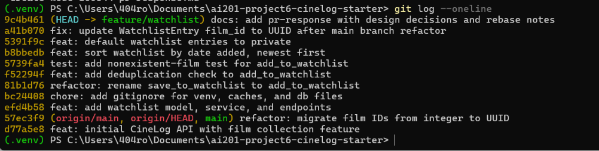

# PR Response Doc — CineLog Watchlist Feature

## AI Usage
<!-- See note — adapt this to what is true for you -->
I used an AI assistant for orientation and verification, not to make design decisions
or write the design arguments. Specifically: I asked it to summarize the existing
collection service and test structure so I could follow the established patterns; I
wrote the deduplication logic and the design responses myself; and I used it as a
devil's advocate to stress-test my Comment 4 and Comment 5 arguments before finalizing
them. Where it surfaced a gap, I revised my own reasoning rather than adopting its wording.

## Comment 1 — Rename
**What I did:** Renamed `save_to_watchlist()` to `add_to_watchlist()` in
`services/watchlist_service.py` to follow the project's `verb_to_noun` convention,
matching `add_to_collection()`. Updated the one call site in
`routes/watchlist/watchlist.py` (both the import and the call inside `add_film`).
**How I verified:** Ran a project-wide search (`Select-String -Pattern "save_to_watchlist"`
across all `.py` files) and confirmed zero remaining references. Full test suite stayed green.

## Comment 2 — Deduplication
**What I did:** Added a duplicate check to `add_to_watchlist()`, modeled on
`add_to_collection()` in `services/collection_service.py`. The collection pattern queries
`CollectionEntry` filtered by `user_id` + `film_id`; if a matching row exists, it raises
`AlreadyInCollectionError` before inserting. I mirrored this: `add_to_watchlist()` now
queries `WatchlistEntry` by `user_id` + `film_id`, and if an entry already exists it raises
a new `AlreadyInWatchlistError` (defined in the watchlist service, same style as the
collection exception). The route layer catches it and returns HTTP 409, matching how the
collection route maps `AlreadyInCollectionError`.
**How I verified:** Import smoke-test to confirm the new exception and function load; full
suite stayed green (the new code path is additive and does not affect existing tests).

## Comment 3 — Missing test
**What I did:** Created `tests/test_watchlist.py` with
`test_add_to_watchlist_nonexistent_film_raises`, modeled directly on
`test_add_to_collection_nonexistent_film_raises` in `tests/test_collection.py` — same
`app` and `sample_user` fixtures, same in-memory DB setup, and the same
`pytest.raises(FilmNotFoundError)` structure, using a non-existent UUID as the film_id.
**How I verified:** `pytest tests/test_watchlist.py -v` passes; full suite is 5/5.

## Comment 4 — Default visibility
**My position:** Watchlist entries should default to **private** (`public=False`).
**Reasoning:** Privacy-by-default is the safer failure mode. If a user never touches the
visibility setting, the quiet outcome should be "nobody saw it," not "everyone did." A
watchlist also exposes what someone *intends* to watch — arguably more revealing than the
collection of films they've already logged — so silently broadcasting it by inheriting a
`True` default is a privacy surprise the user never opted into.
**Tradeoff acknowledged:** Defaulting to private means social/discovery features (seeing
friends' watchlists) require an explicit opt-in, so sharing is slightly higher-friction
and public lists may be rarer. I accept that: making a user take one deliberate action to
share is a better default than having them discover after the fact that their list was
public all along.

## Comment 5 — Sort order
**My position:** Accept the maintainer's preference — sort by date added, newest first.
Changed `get_watchlist()` from `Film.title.asc()` to `WatchlistEntry.date_added.desc()`.
**Reasoning:** This makes the watchlist consistent with how the collection already sorts
(`get_collection()` returns newest-first), so the two user lists behave predictably the
same way instead of each having its own arbitrary order. The original alphabetical sort had
no user-behavior justification behind it; the maintainer's "most users want to see what
they added recently" is the stronger rationale, and consistency across the two lists seals it.
**Engagement with reviewer's point:** I agree with the reviewer's reasoning directly. The
tradeoff I'm giving up is that alphabetical order is easier when hunting for one specific
known title in a long list — but that's better served by search/filter than by making
recency harder to see, so date-added is the right default.

## Comment 6 — Rebase
**What conflicted:** `models.py`, in the `WatchlistEntry` class. The `main` refactor
changed `film_id` to a UUID (`db.String(36)`), while my branch's original commit still
declared it as `db.Integer`. The conflict was on the `film_id` column definition.
**How I resolved it:** Kept main's UUID version (`db.String(36)`, `ForeignKey("film.id")`)
and preserved the `index=True` that the original integer column had, since indexing
`film_id` benefits watchlist lookups. I then made a separate `fix:` commit updating the
remaining integer references in the watchlist docstrings (`film_id (int)` → `film_id (str)`
UUID, and the route body example `<int>` → `<uuid>`).
**How I verified no conflict remains:** `git status` shows the rebase completed with no
unmerged paths and no merge commits; `git log --oneline` shows my commits replayed on top
of main's UUID refactor; `pytest tests/ -v` passes 5/5.

## PR Description
Adds a watchlist feature so users can save films they want to watch, mirroring the existing
collection feature's structure. Includes the `WatchlistEntry` model, `add_to_watchlist()` /
`get_watchlist()` service functions with duplicate protection, and REST endpoints
(`GET /watchlist/<user_id>`, `POST /watchlist/<user_id>/add`).

Design decisions: watchlist entries default to **private** (privacy-by-default; see Comment 4),
and the watchlist sorts **newest-first** to stay consistent with the collection (see Comment 5).
Film IDs use UUIDs, consistent with the main-branch refactor.

Manual testing: start the app (`python app.py`), then POST a valid `film_id` to
`/watchlist/<user_id>/add` (expect 201), POST the same one again (expect 409 duplicate),
and POST a non-existent `film_id` (expect 404). `GET /watchlist/<user_id>` returns entries
newest-first. Automated: `pytest tests/ -v` (5 passing).

