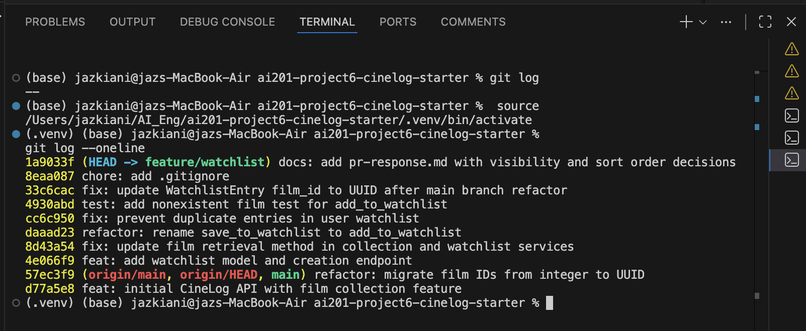

# PR Response Doc — CineLog Watchlist Feature

## AI Usage
I used Claude Code in VS Code throughout this project. I made the decisions myself and checked what it gave me against the code before keeping anything.

- **Codebase orientation:** Before changing anything, I asked it to summarize `models.py`, `services/collection_service.py` and `tests/test_collection.py`. I asked what each file is responsible for and what it depends on. I also had it walk me through `add_to_collection()` step by step, including what happens when the `film_id` doesn't exist. That's how I found the duplicate-check pattern I copied for Comment 2 and the fixture and assertion structure I copied for the Comment 3 test.
- **Triaging the review:** I asked it to read all six comments and label each one as a code change, a written response or a decision before I touched anything. I made the two decisions (public by default, newest first) and told it to write them down as notes only, without changing code.
- **Stress-testing Comments 4 and 5:** After writing my first version of Comment 4, I asked: "What counterargument would a careful code reviewer raise against this position? What tradeoff am I not acknowledging?" It came back with several points:
  - The two mistakes aren't equally reversible. Starting private and later switching to public harms nobody, but data already exposed can't be taken back.
  - Rows saved now stay `public=True`, so changing the default later needs a migration, not a one-line change.
  - The routes have no access control at all.
  - Hiding entries one at a time is a lot of work for a user who wants a private list.
  - Watch history can be sensitive.

  It also recommended shipping `default=False` now and switching to public in a follow-up PR.

  **How my final argument differs:** I kept my position of public by default. I took the reversibility point and the sensitivity point into my "Tradeoff acknowledged" section, and the access-control, migration and per-entry-effort points into "Gaps in this PR." I didn't take its recommendation to flip the default, because a watchlist's value comes from being seen. Instead I state that cost openly, so the reviewer can weigh it. The AI's revision also added a "Plan" section committing to follow-up work, plus a `contains_eager` query change for Comment 5. I removed both, because they went beyond the six review comments and described work this PR doesn't do. For Comment 5, I kept its point that a test relying on default timestamps could fail at random, and I added `Film.title` as a tie-breaker in the sort.


## Comment 1 — Rename
**What I did:** I renamed `save_to_watchlist()` to `add_to_watchlist()` in `services/watchlist_service.py`, so it follows the project's verb_to_noun naming and matches `add_to_collection()`. I also updated the two places that used the old name in `routes/watchlist/watchlist.py`: the import and the call in the `add_film` endpoint. The rename is in its own commit (`daaad23`), separate from the deduplication change.
**How I verified:** I searched the whole project for `save_to_watchlist` and found no remaining uses. Then I ran the test suite (`.venv/bin/python -m pytest -q`), and all 5 tests passed. The suite exercises the new name in two ways: every test builds the app, which imports `routes/watchlist/watchlist.py` and would fail on a stale import, and `tests/test_watchlist.py` imports and calls `add_to_watchlist` directly.

## Comment 2 — Deduplication
**What I did:** I followed the pattern in `add_to_collection()` (`services/collection_service.py`). After confirming the film exists, that function queries `CollectionEntry` for a row with the same `user_id` and `film_id`. If one exists, it raises `AlreadyInCollectionError` before anything is added, so no second row is written. `add_to_watchlist()` now does the same and raises `AlreadyInWatchlistError`.
**How I verified:** I ran the existing test suite with the project virtualenv (`.venv/bin/python -m pytest -q`), and all 4 tests passed (this was before the Comment 3 test was added). Those tests only cover the collection feature, so they show the change didn't break anything but don't exercise the new duplicate check. I then sent requests to the add route: the first add returned 201, the duplicate was refused, and the watchlist still contained one entry. There is no automated test for the watchlist duplicate case yet.

**Known gap:** The collection route catches `AlreadyInCollectionError` and returns 409, but the watchlist route (`routes/watchlist/watchlist.py`) doesn't catch `AlreadyInWatchlistError` or `FilmNotFoundError`. The duplicate is blocked, but the client gets an HTTP 500 instead of a 409, and a nonexistent film also returns 500 instead of 404. This PR doesn't fix that.

## Comment 3 — Missing test
**What I did:** I added `tests/test_watchlist.py` with `test_add_to_watchlist_nonexistent_film_raises` (commit `4930abd`). It calls `add_to_watchlist()` with a film ID that isn't in the database and asserts that it raises `FilmNotFoundError`. The test is modelled on `test_add_to_collection_nonexistent_film_raises` in `tests/test_collection.py` and uses the same fixtures: an isolated app with an in-memory SQLite database, and a sample user.
**How I verified:** The new test passes, and so does the full suite (`.venv/bin/python -m pytest -q`, 5 passed). To make sure the test actually catches the bug, I temporarily removed the film-exists check from `add_to_watchlist()` and ran it again. It failed with `DID NOT RAISE FilmNotFoundError`, and then I restored the code. That run also showed that without the check, the in-memory SQLite database doesn't enforce the foreign key, so the call silently creates an entry pointing at a film that doesn't exist. The service-level check is what prevents this.

## Comment 4 — Default visibility
**My position:** Keep watchlist entries public by default (`public=True`). I chose this on purpose; it isn't just an inherited default.

**Reasoning:** A watchlist is mainly a way to share and find films ("here's what I want to see next"). Most of that value comes from other people being able to see it, so a public default means sharing works without the user doing anything first. Visibility is stored per entry rather than per list, so a user can hide individual films they'd rather keep to themselves without hiding the whole watchlist.

**Tradeoff acknowledged:** The strongest argument against this is privacy by default. Users may not expect their list to be visible, and a public default exposes data they never chose to share. What people want to watch can also be sensitive, since it can hint at things like religion, politics or sexuality. The two kinds of mistake also aren't equally fixable. If we start private and later decide public was right, we can flip the default and ask users to opt in, and nobody is harmed. If we start public and later decide private was right, we can't take back what people have already seen.

**Gaps in this PR:** The public default carries more weight because of what this PR doesn't do yet:
- There is no endpoint yet for changing an entry's `public` flag, so users currently can't make anything private.
- `get_watchlist` and `GET /watchlist/<user_id>` don't filter on `public`, so the flag isn't enforced yet. The API still returns `public` on every entry, so a client could wrongly assume `public: false` means hidden.
- The watchlist routes don't check who is calling. Anyone with a user's ID can read that user's watchlist through `GET /watchlist/<user_id>`, and can add films to it through `POST /watchlist/<user_id>/add`. Until that's fixed, the default value doesn't change who can see what.
- Every entry saved now is stored with `public=True`. When filtering ships, those entries become the actually public ones, even though they were saved before users had any way to choose. That also means changing the default later isn't a one-line change. `default=True` only applies to new rows, so existing rows would need a migration, and we'd have to decide what they should become.
- Because visibility is set per entry, a user who wants a fully private watchlist has to hide each film one at a time, including every film they add later. There's no per-user "make my watchlist private" setting.


## Comment 5 — Sort order
**My position:** Watchlists will be sorted by date added, newest first.

**Reasoning:** People usually open a watchlist to find something they saved recently, so the newest entries should be at the top. This also matches `get_collection()`, which already sorts by `date_added` descending, so both of a user's lists behave the same way. In code, `.order_by(Film.title.asc())` becomes `.order_by(WatchlistEntry.date_added.desc(), Film.title.asc())`.


**Engagement with reviewer's point:** I considered keeping alphabetical order, since it makes it easier to check whether a particular film is already on a long list. But that's a lookup task, and a search or filter would handle it better than the default order. The default should suit the most common use, which is seeing what was added recently, so I agree with your preference. Alphabetical sorting could be offered later as an optional query parameter (e.g. `?sort=title`) without changing the default. I'll add a test, modelled on `test_get_collection_returns_newest_first`, that checks the newest-first order. The test will set `date_added` explicitly on each entry instead of relying on default timestamps. Entries created in quick succession can get the same timestamp, which would make the test fail at random.

## Comment 6 — Rebase
**What conflicted:** I rebased `feature/watchlist` onto `main`, which includes `57ec3f9` ("refactor: migrate film IDs from integer to UUID"). There was one conflict, in `models.py`, on the `WatchlistEntry.film_id` line. The conflict came up while replaying my first commit ("added watchlist model and endpoint…"). `main` had changed the column from `db.Integer` to `db.String(36)` so it matches the new UUID primary key on `Film`. My branch had changed the same line to add `index=True`, but it still used `db.Integer`. Git couldn't combine the two edits automatically.

**How I resolved it:** I kept both changes: main's UUID type and my index. The line is now `film_id = db.Column(db.String(36), db.ForeignKey("film.id"), nullable=False, index=True)`. Keeping `db.Integer` was not an option, because the foreign key would then point at a UUID string column, and my commit would have undone part of main's migration. Resolving a conflict mid-rebase puts the fix into the commit being replayed, so this change is part of the rebased first commit (`4e066f9`). When the rebase finished, I searched the watchlist code for any other places that still treated `film_id` as an integer. I found two: the `POST /watchlist/<user_id>/add` docstring in `routes/watchlist/watchlist.py` documented the body as `{ "film_id": <int> }`, and the `add_to_watchlist()` docstring in `services/watchlist_service.py` said `film_id (int) … (Note: integer — pre-refactor)`. I changed both to describe a UUID string, using the same wording as the collection route and service. That change has its own commit: `33c6cac` ("fix: update WatchlistEntry film_id to UUID after main branch refactor").

**How I verified no conflict remains:**
- `git status` shows the rebase finished, with no unmerged paths.
- `git grep` for `<<<<<<<`, `=======` and `>>>>>>>` in the `.py` files finds no leftover conflict markers.
- `git merge-base main HEAD` returns `57ec3f9`, which is the current tip of `main` (and matches `origin/main`). The branch sits directly on top of main's UUID refactor.
- `git log --merges main..HEAD` finds no merge commits. The history is linear, with 7 commits on top of `57ec3f9`: my 5 rebased commits (`4e066f9` through `4930abd`), then the UUID docstring fix (`33c6cac`), then `.gitignore` (`8eaa087`) and the final `docs:` commit that adds this document.
- The only `db.Integer` columns left in `models.py` are `Film.year` and `CollectionEntry.rating`, which are meant to be integers. No ID column uses `db.Integer` any more.
- The full test suite passes (`.venv/bin/python -m pytest -q`, 5 passed). `test_add_to_watchlist_nonexistent_film_raises` already passes a UUID-format film ID, so it runs against the UUID schema.

**Screenshot (rebase verification):**


## PR Description
## What this does

Adds a watchlist to CineLog: users can save films they want to watch later, separate from the collection of films they've already logged. It adds a `WatchlistEntry` model and two endpoints:

- `POST /watchlist/<user_id>/add` to save a film.
- `GET /watchlist/<user_id>` to view the list.

A film can only be on a user's watchlist once, and a film ID that doesn't exist is not saved. Both cases currently return HTTP 500, not 409/404 (see Current limits).

### Endpoints

| Method | Endpoint | Description |
|--------|----------|-------------|
| GET | `/watchlist/<user_id>` | Get a user's watchlist |
| POST | `/watchlist/<user_id>/add` | Add a film. Body: `{ "film_id": "<uuid>" }`. Returns 201 with the new entry, 400 if `film_id` is missing, or 500 for a duplicate or nonexistent film. |

## Design decisions

### 1. Visibility default: entries are public by default (`public=True`)

This is a deliberate choice. A watchlist is mainly for sharing and discovery ("here's what I want to see next"), so a public default means sharing works without any setup. Visibility is stored per entry, not per list, so individual films can be hidden without hiding the whole list.

**Tradeoff:** Privacy by default is the strongest counterargument. What someone wants to watch can hint at sensitive things (religion, politics, sexuality), and the two possible mistakes aren't equally fixable. Going from private to public later just means asking users to opt in. Going from public to private can't undo what people have already seen.

**Current limits:**
- There's no endpoint to change an entry's `public` flag.
- `GET /watchlist/<user_id>` doesn't filter on `public`. Every entry is returned and the field is informational only.
- The watchlist routes don't check who is calling.
- Existing rows are stored as `public=True`, so changing the default later would need a migration.
- The add route doesn't catch `AlreadyInWatchlistError` or `FilmNotFoundError`, so a duplicate or nonexistent film returns HTTP 500 instead of 409/404. No row is written in either case.

### 2. Intended sort order: newest first (by `date_added`, then title)

People usually open a watchlist to find something they saved recently, so new entries should go at the top. This matches `get_collection()`, so a user's two lists behave the same way. Alphabetical order would make it easier to check whether a film is already on a long list, but that's a lookup task better served by search or a future `?sort=title` option.

**Current implementation:** The decision is documented but has not yet been implemented. `get_watchlist()` currently sorts alphabetically using `.order_by(Film.title.asc())`. Therefore, the manual test below expects alphabetical order.

## Other changes

- Renamed `save_to_watchlist()` to `add_to_watchlist()` to match `add_to_collection()`.
- `add_to_watchlist()` now checks for an existing entry and raises `AlreadyInWatchlistError` instead of adding a duplicate.
- Added `tests/test_watchlist.py` with a test that a nonexistent film raises `FilmNotFoundError`.
- Rebased onto `main`'s UUID refactor (`57ec3f9`). `WatchlistEntry.film_id` is now `db.String(36)` with an index, and the docstrings describe it as a UUID.

## How to test manually

### 1. Set up and start the app

```bash
pip install -r requirements.txt
python seed.py
python app.py
```

The seed script prints the demo user's `user_id`. Copy it.

If the database was already seeded, get the ID with:

```bash
sqlite3 instance/cinelog.db "select id from user where username='demo';"
```

### 2. Set variables and find film IDs

In a second terminal:

```bash
USER=<demo_user_id>
curl -s http://localhost:5000/films/
```

Copy the `id` values for *Spirited Away*, *Alien*, and *Paddington 2*.

### 3. Check that the watchlist starts empty

```bash
curl -s http://localhost:5000/watchlist/$USER
```

**Expected:** `[]`

### 4. Add three films

Add Spirited Away, then Alien, then Paddington 2. Run the following command once for each film, replacing `<film_id>` with that film's UUID:

```bash
curl -s -X POST http://localhost:5000/watchlist/$USER/add \
  -H "Content-Type: application/json" \
  -d '{"film_id": "<film_id>"}'
```

**Expected:** Each request returns HTTP 201 with the new entry's JSON in the response.

### 5. View the watchlist

```bash
curl -s http://localhost:5000/watchlist/$USER
```

**Expected:** Three films, each with `"public": true` and a `date_added` timestamp, in alphabetical order: Alien, Paddington 2, Spirited Away.

### 6. Add a duplicate

Re-send the Alien request from Step 4 with the status code shown, then repeat Step 5:

```bash
curl -s -o /dev/null -w "%{http_code}\n" -X POST http://localhost:5000/watchlist/$USER/add \
  -H "Content-Type: application/json" \
  -d '{"film_id": "<alien_film_id>"}'
```

**Expected:** `500` (the route doesn't map the duplicate error to 409 yet). The watchlist still contains exactly three films.

### 7. Send a request with no `film_id`

```bash
curl -s -w "\n%{http_code}\n" -X POST http://localhost:5000/watchlist/$USER/add \
  -H "Content-Type: application/json" \
  -d '{}'
```

**Expected:** HTTP 400 with `{"error": "film_id is required"}`.

### 8. Run the automated tests

```bash
python -m pytest -q
```

**Expected:** 5 passed.